# Лабораторная работа 6 - Введение в FastAPI

## Задание 1. Подготовительный этап: создание проекта и первого коммита

Была создана новая директория для проекта, после чего инициализирован репозиторий командой `git init` (рис. 1). В корне проекта был создан файл `.gitignore`, содержащий предлагающийся шаблон. После, проект был инициализирован с использованием команды `uv init`. С помощью `uv` было создано и активировано виртуальное окружение, а также установлены FastAPI и Uvicorn (рис. 1).

  <a href="images/01.png">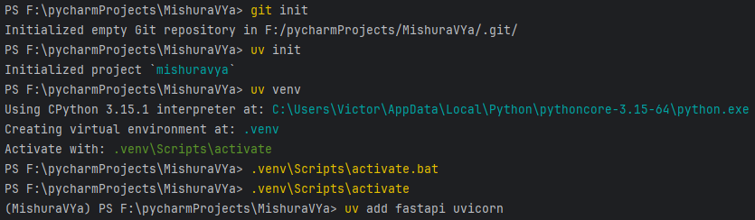</a> 
  <em>Рис. 1. Подготовительный этап</em>

В корне проекта был создан файл `main.py` с минимальным приложением FastAPI (рис. 2).

  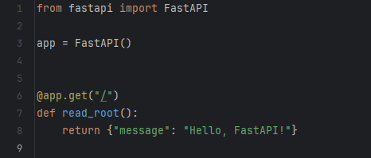 
  <em>Рис. 2. Базовое приложение</em>

С помощью команды `uvicorn main:app --reload`, приложение было запущено на localhost (рис. 3).

  <a href="images/03.png">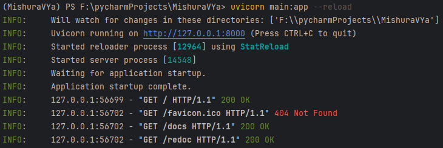</a> 
  <em>Рис. 3. Первый запуск приложения</em>

После запуска, при обращении к корню приложения, возвращается JSON-ответ с заданным сообщением (рис. 4).

  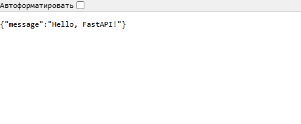 
  <em>Рис. 4. JSON-ответ</em>

При обращении к `/docs`, появляется OpenAPI документация приложения (рис. 5).

  <a href="images/05.png">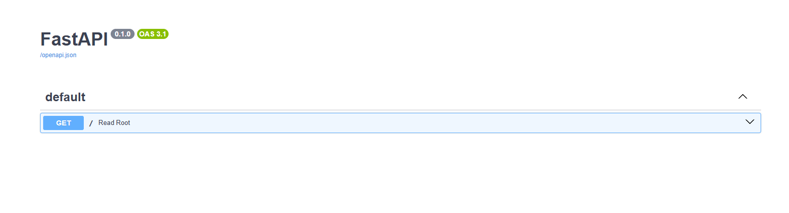</a> 
  <em>Рис. 5. OpenAPI документация</em>

При обращении к `/redoc`, появляется Redoc документация приложения (рис. 6).

  <a href="images/06.png">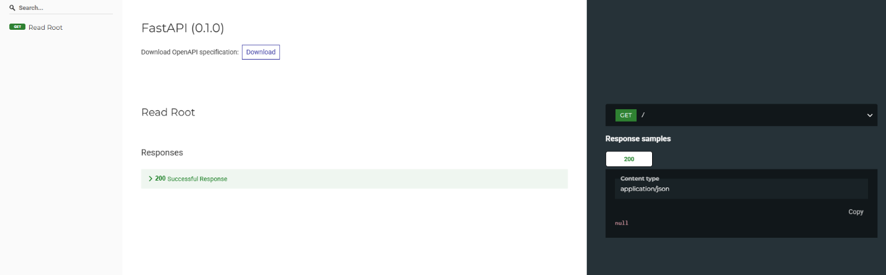</a> 
  <em>Рис. 6. Redoc документация</em>

После этого сервер был остановлен, и был сделан первый `init` коммит (рис. 7).

  <a href="images/07.png">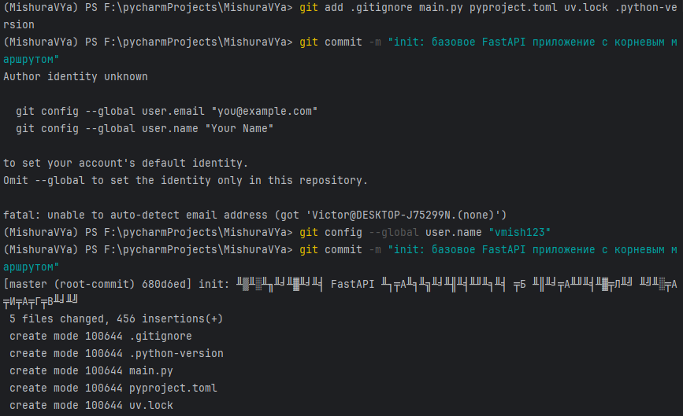</a> 
  <em>Рис. 7. Первый коммит</em>

---

## Задание 2. Добавление нового эндпоинта с параметрами пути и query

В `main.py` был добавлен ещё один эндпоинт, принимающий два параметра и возвращающий словарь с ними (рис. 8).

  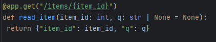 
  <em>Рис. 8. Функция, возвращающая словарь</em>

Аналогично первому заданию, приложение было запущено на localhost. После обращения по адресу <http://127.0.0.1:8000/items/42?q=test>, возвращается JSON-ответ, представленный на рисунке 9, содержащий в себе переданные параметры в виде словаря.

  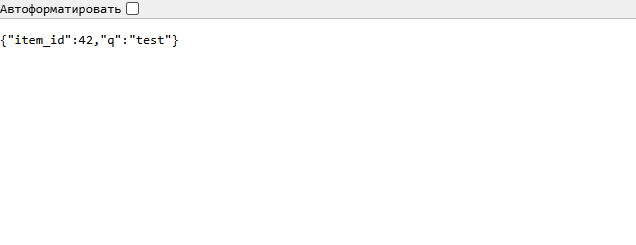 
  <em>Рис. 9. JSON-ответ</em>

Тестирование работы эндпоинта в OpenAPI документации представлено на рисунке 10.

  <a href="images/10.png">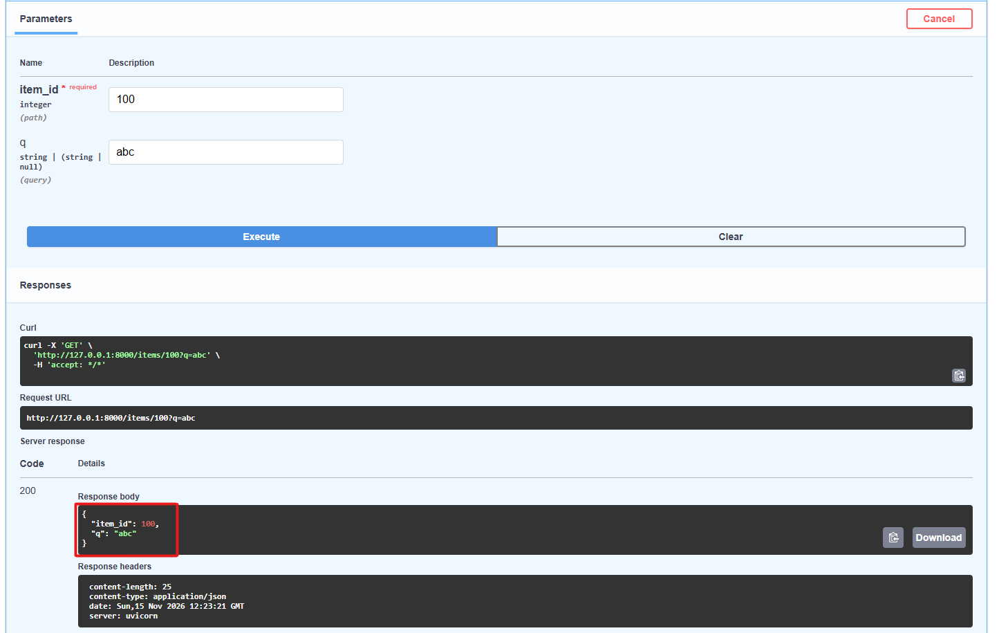</a> 
  <em>Рис. 10. Тестирование эндпоинта</em>

После этого сервер был остановлен, и был сделан второй `feat` коммит (рис. 11).

  <a href="images/11.png">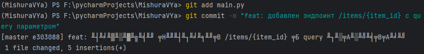</a> 
  <em>Рис. 11. Второй коммит</em>

---

## Задание 3. Создание модели Pydantic и обработка POST-запроса

С помощью `uv` была установлена библиотека Pydantic. В списке `dependencies` файла `pyproject.toml` появилась установленная библиотека (рис. 12).

  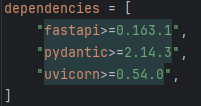 
  <em>Рис. 12. Установленный Pydantic</em>

В `main.py` определена модель `Item` и добавлен эндпоинт создания товара, возвращающий передаваемый ему же параметр (рис. 13).

  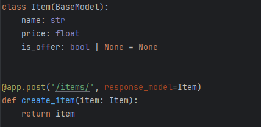 
  <em>Рис. 13. Изменения main.py</em>

При проверке эндпоинта в `/docs`, приложение возвращает передаваемый ему же объект (рис. 14).

  <a href="images/14.png">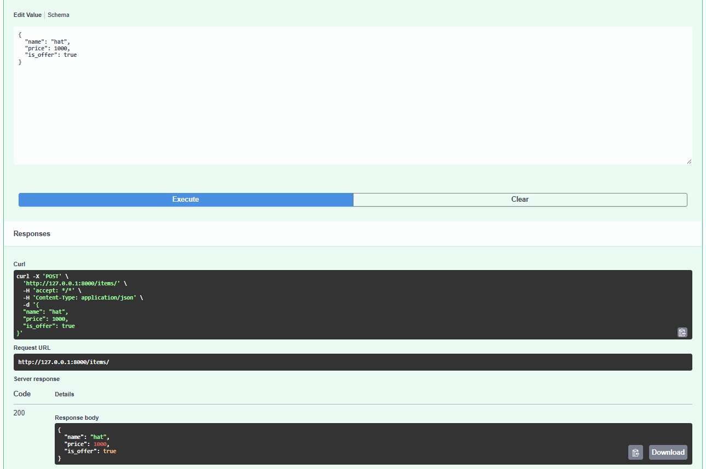</a> 
  <em>Рис. 14. Тестирование create_item</em>

После этого сервер был остановлен, и был сделан третий `feat` коммит (рис. 15).

  <a href="images/15.png">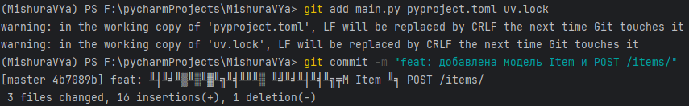</a> 
  <em>Рис. 15. Третий коммит</em>

---

## Задание 4. Организация кода: вынос маршрутов в отдельные роутеры

В корне проекта был создан пакет `app`, а в нём – пакет `routers` (рис. 16).

  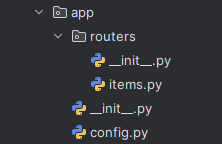 
  <em>Рис. 16. Новая структура</em>

В файл `items.py` были перенесены все эндпоинты, связанные с товарами, используя `APIRouter` (рис. 17).

  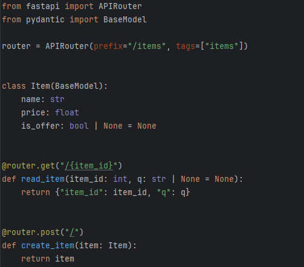 
  <em>Рис. 17. items.py</em>

В основном же файле `main.py` был подключен роутер (рис. 18).

  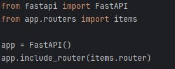 
  <em>Рис. 18. main.py</em>

После чего было запущено приложение и произведена проверка, что все маршруты, как и прежде, располагаются по прежним адресам (рис. 19, 20, 21).

  <a href="images/19.png">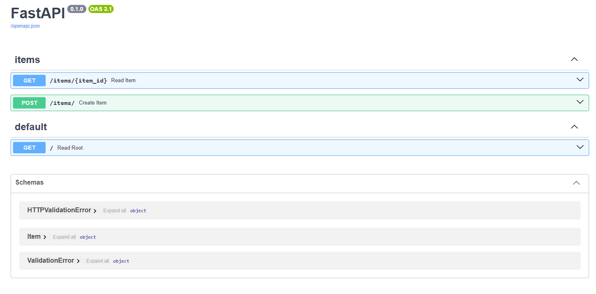</a> 
  <em>Рис. 19. /docs</em>

  <a href="images/20.png">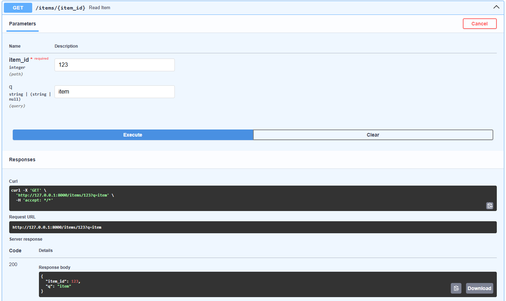</a> 
  <em>Рис. 20. Метод GET</em>

  <a href="images/21.png">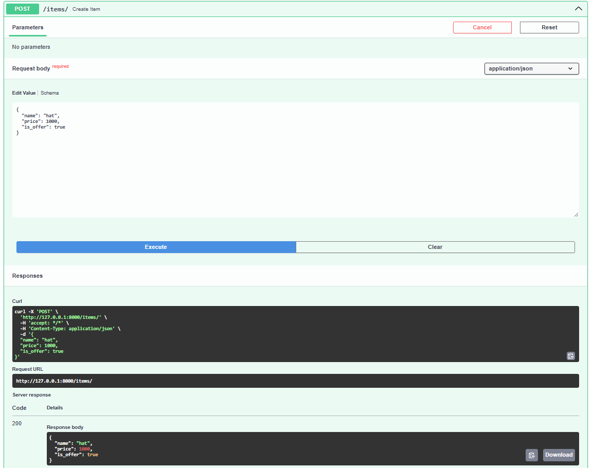</a> 
  <em>Рис. 21. Метод POST</em>

После этого сервер был остановлен, и был сделан четвёртый `feat` коммит (рис. 22).

  <a href="images/22.png">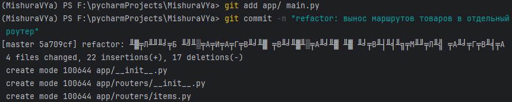</a> 
  <em>Рис. 22. Четвёртый коммит</em>

---

## Задание 5. Добавление конфигурации через Pydantic Settings

После установки `pydantic-settings` в пакете `app` был создан файл `config.py` (рис. 23), содержащий класс настроек.

  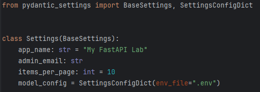 
  <em>Рис. 23. config.py</em>

В корне проекта создан файл `.env` с переменными окружения (рис. 24).

  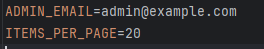 
  <em>Рис. 24. Переменные окружения</em>

В `main.py` создан экземпляр настроек, и в FastAPI передан `title`. Также добавлен эндпоинт возвращающий информацию о настройках (рис. 25).

  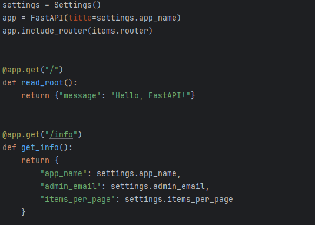 
  <em>Рис. 25. Изменения в main.py</em>

Обращаясь к `/info`, можно убедиться, что значение `items_per_page` подхватилось из `.env` (рис. 26).

  <a href="images/26.png">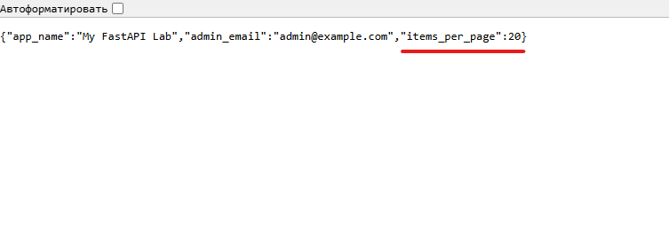</a> 
  <em>Рис. 26. Ответ /info</em>

В документации `/docs` появился GET-метод, возвращающий информацию о настройках (рис. 27).

  <a href="images/27.png">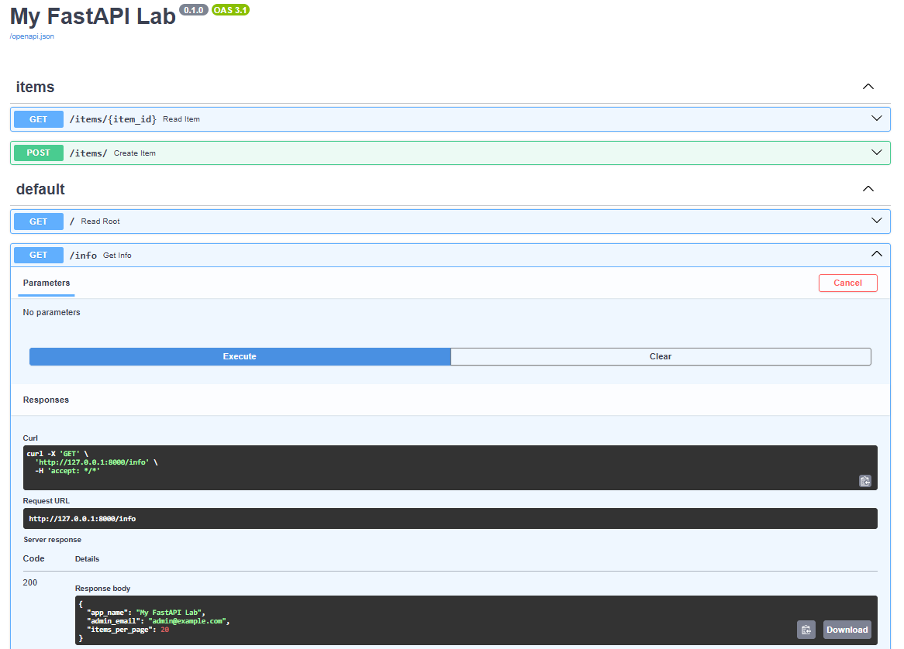</a> 
  <em>Рис. 27. Ответ /info</em>

После этого сервер был остановлен, и был сделан пятый `feat` коммит (рис. 28).

  <a href="images/28.png">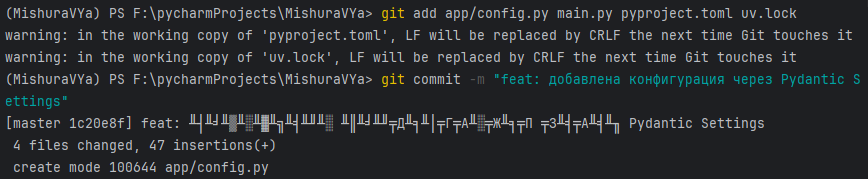</a> 
  <em>Рис. 28. Пятый коммит</em>

---

## Задание 6. Обработка ошибок и улучшение документации

Эндпоинт `GET /items/{item_id}` был модифицирован. На уровне модуля был создан словарь, содержащий в себе одну запись с товаром. Функция `read_item` проверяет наличие товара в словаре, и, в случае его отсутствия, поднимает `HTTPException` с кодом 404 (рис. 29). Также добавлено описание параметров.

  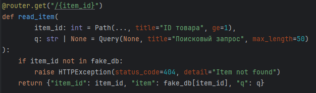 
  <em>Рис. 29. Изменённый GET метод</em>

Для модели `Item` добавлены примеры и описания полей через `Field` (рис. 30).

  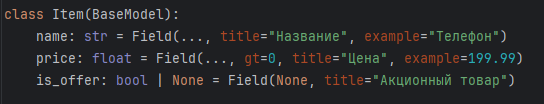 
  <em>Рис. 30. Изменённая модель Item</em>

В `main.py` были указаны метаданные приложения (рис. 31).

  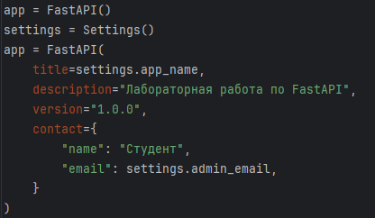 
  <em>Рис. 31. Добавление метаданных</em>

После запуска приложения, в документации можно наблюдать изменения названия, описания, версии и контактов (рис. 32).

  <a href="images/32.png">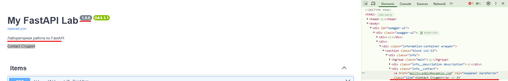</a> 
  <em>Рис. 32. Изменившиеся метаданные</em>

Для POST и GET запросов появились образцы данных (рис. 33, 34).

  <a href="images/33.png">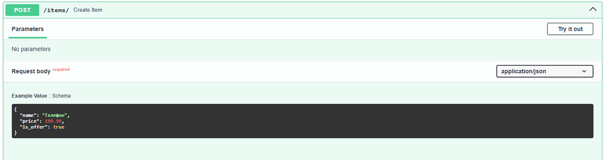</a> 
  <em>Рис. 33. Образец данных</em>

  <a href="images/34.png">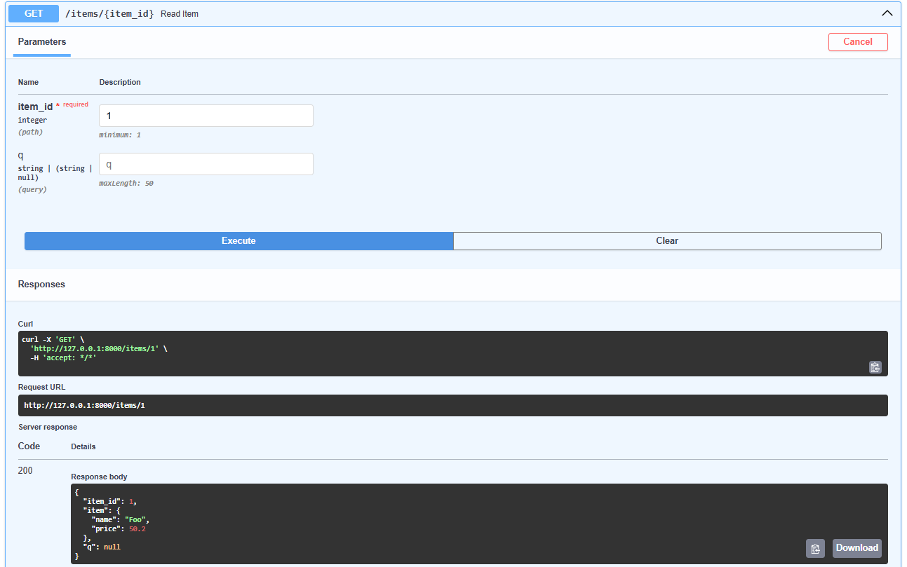</a> 
  <em>Рис. 34. Образец данных</em>

При попытке GET-запроса с невалидным значением `item_id`, появляется уведомление (рис. 35).

  <a href="images/35.png">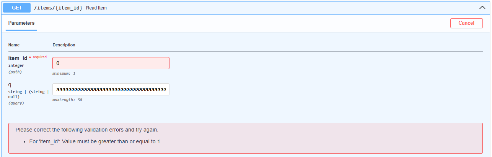</a> 
  <em>Рис. 35. Неверный item_id</em>

При попытке передать в качестве параметра слишком большую строку, возвращается ответ с ошибкой 422 (рис. 36).

  <a href="images/36.png">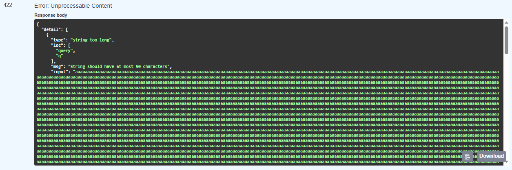</a> 
  <em>Рис. 36. Слишком большая строка</em>

При попытке запросить товар с несуществующим `item_id`, возвращается ответ с ошибкой 404 (рис. 37).

  <a href="images/37.png">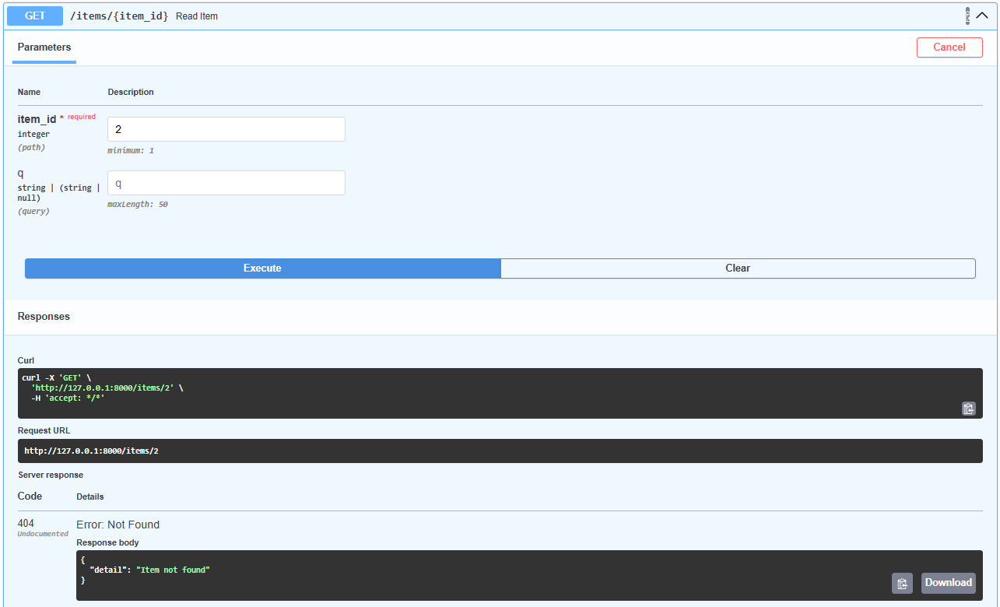</a> 
  <em>Рис. 37. Товар не найден</em>

После этого сервер был остановлен, и был сделан шестой `feat` коммит (рис. 38).

  <a href="images/38.png">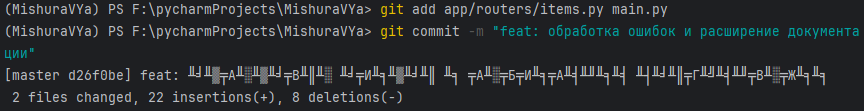</a> 
  <em>Рис. 38. Шестой коммит</em>

---

## Задание 7. Добавьте эндпоинт для обновления товара (`PUT /items/{item_id}`) с проверкой существования

В `items.py` была добавлена функция валидации на уникальность имени товара (рис. 39).

  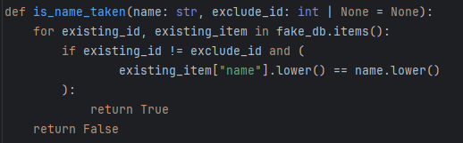 
  <em>Рис. 39. Валидация имени на уникальность</em>

Эндпоинт POST был модифицирован, и позволяет сохранить новый товар в базу данных. В методе также используется валидация имени, представленная выше (рис. 40).

  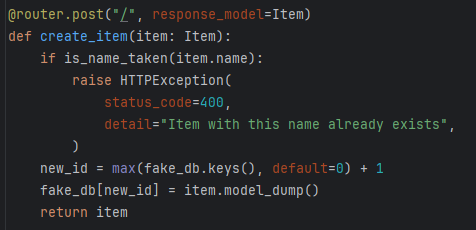 
  <em>Рис. 40. Метод POST</em>

Был добавлен эндпоинт PUT, перезаписывающий запись `fake_db[item_id]` новыми данными в случае, если успешно пройдена валидация входных данных (рис. 41).

  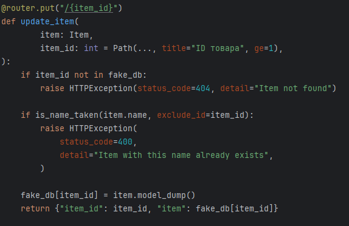 
  <em>Рис. 41. Метод PUT</em>

В случае, если происходит попытка обновить запись с несуществующим `item_id`, возвращается ошибка 404 (рис. 42).

  <a href="images/42.png">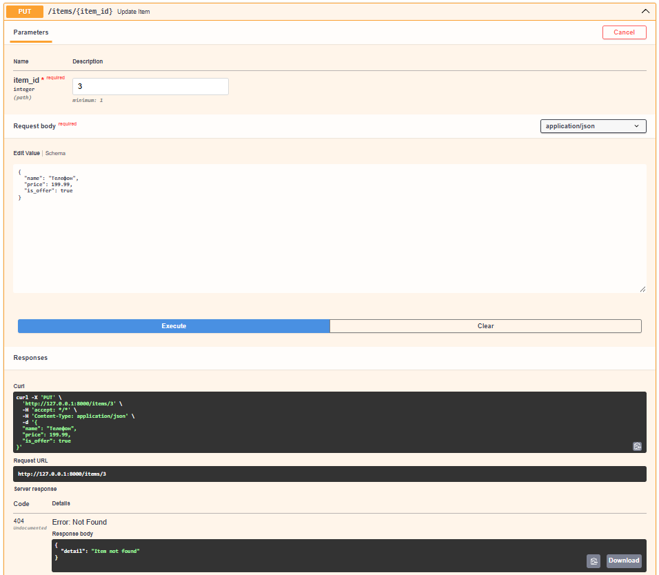</a> 
  <em>Рис. 42. Обновление несуществующей записи</em>

В случае, если имя уникально и `item_id` существует, запись в базе данных обновляется (рис. 43).

  <a href="images/43.png">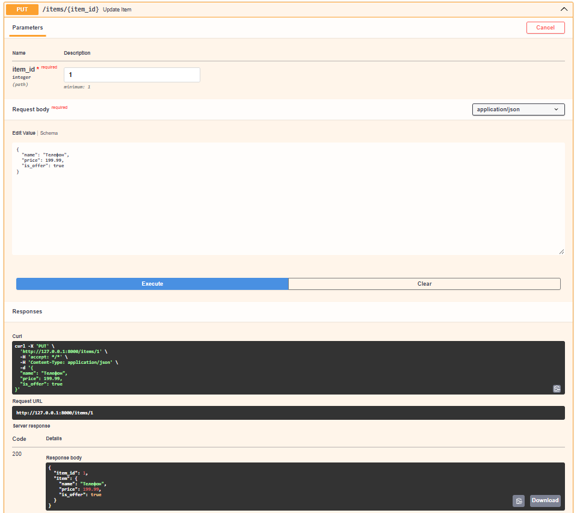</a> 
  <em>Рис. 43. Успешное обновление записи</em>

После этого сервер был остановлен, и был сделан седьмой `feat` коммит (рис. 44).

  <a href="images/44.png">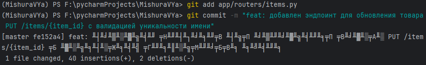</a> 
  <em>Рис. 44. Седьмой коммит</em>

---

## Задание 8. Добавьте логирование

Для отслеживания работы приложения было добавлено логирование с использованием `logging`. В `main.py` был создан логгер, фиксирующий события на уровне `INFO`, и выводящий сообщения в консоль и в файл `logs.log` (рис. 45). Этот же логгер был подключен в `items.py`.

  <a href="images/45.png">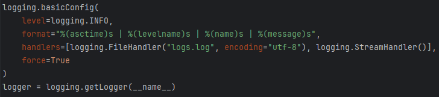</a> 
  <em>Рис. 45. Настройка логирования</em>

Вывод логов в консоль и в файл представлены на рисунках 46 и 47 соответственно.

  <a href="images/46.png">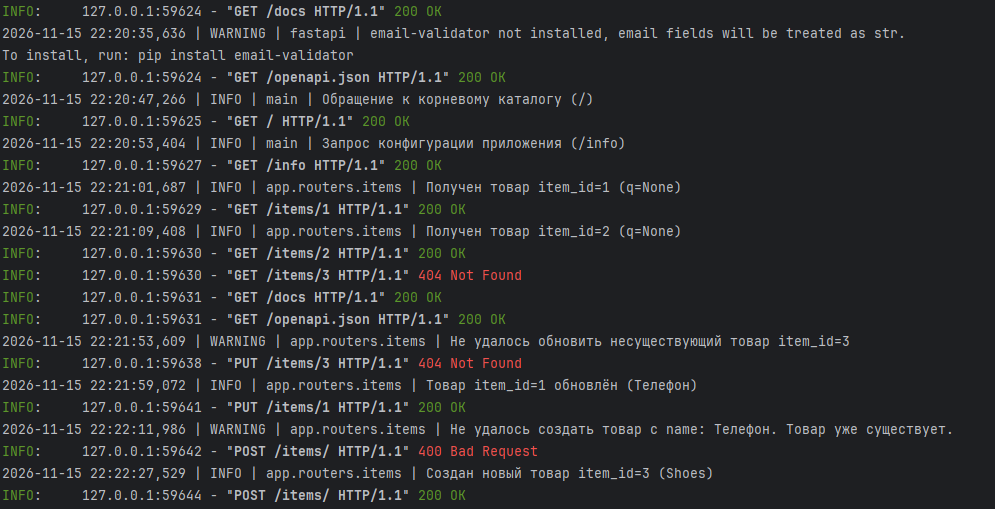</a> 
  <em>Рис. 46. Вывод логов в консоль</em>

  <a href="images/47.png">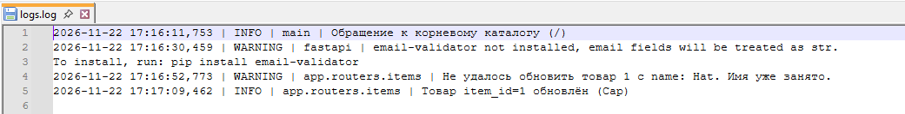</a> 
  <em>Рис. 47. Вывод логов в файл</em>

После этого сервер был остановлен, и был сделан восьмой `feat` коммит (рис. 48).

  <a href="images/48.png">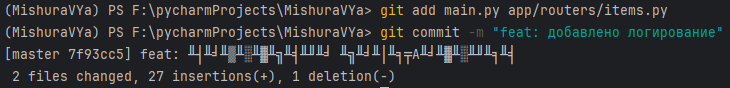</a> 
  <em>Рис. 48. Восьмой коммит</em>

